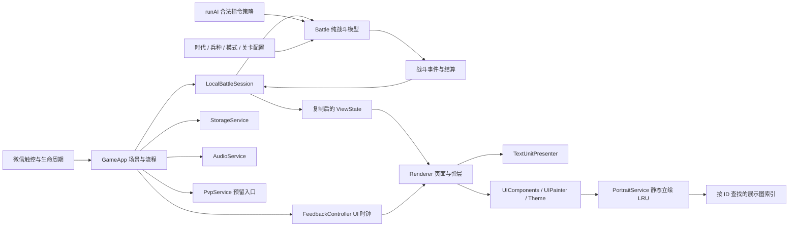

# 文字单机原型架构

更新：2026-10-09；配置版本：`text-prototype-0.2`。已完成 UI、触控反馈及 30 兵静态立绘接入，沿用战斗规则和存储版本。

当前单机玩法已实现，静态页面使用已验收立绘；战场仍由 `TextUnitPresenter` 绘制文字。PvP 大厅可以进入，实际联网服务尚未接入。通用 `animation.js` 与对应测试保留，当前战场不引用该动作模块。新规范与 30 兵提示词见 [美术规范](art.md)，提示词不参与运行时加载。

## 模块与数据流

`Battle` 不读取微信 API、真实时间或图片；随机数来自可保存的种子。玩家与 AI 都走 `command(side, command)`，校验后才能扣费或修改队列。`LocalBattleSession` 把渲染时间积累为 1/30 秒逻辑步，暂停时停止全部模拟时钟。表现模块只读视图，不回写生命、位置或伤害。

| 文件 | 拥有的状态或职责 |
|---|---|
| `data.js` | 30 兵种的 ID、唯一短名、数值、标签、前摇、弹丸和图鉴说明 |
| `config/modes.js` | 经典和战役模式、15 关目标、时代范围、初始值及敌军加成 |
| `battle.js` | 金币、EXP、队列、单位、塔、弹丸、技能、种子、统计和最终结果 |
| `core/ai.js` | 三档决策频率、战役出兵组合、补兵间隔和防御策略 |
| `sessions/local.js` | 暂停、步长积累、指令应答与去重、事件缓冲和视图复制 |
| `app.js` | 当前场景、弹层、镜头、手势、设置、通关进度和服务实例 |
| `renderer.js`、`ui/screens.js` | 首页、战役、图鉴、设置、PvP 大厅、战场与通用弹层 |
| `ui/theme.js`、`ui/primitives.js` | 统一色彩、动效时长、Canvas 原生形状和图标 |
| `ui/components.js` | 文本排版、卡片、徽章、按钮、控件注册、形状裁剪和反馈绘制 |
| `ui/feedback.js` | 按压、回弹、波纹、成功／拒绝高亮；最多保留 12 项短暂效果 |
| `ui/units.js` | 短名、阵营、血量、状态、密集单位分组和标签避让 |
| `services/storage.js` | 读写失败处理、数据校验、顺序解锁和结算去重 |
| `services/audio.js` | 本地短音效、音量、关闭与后台停止 |
| `services/portraits.js`、`config/unit-portraits.js` | 按 ID 按需加载、加载结果、错误回退、最多 12 张 LRU 与构建生成的尺寸索引 |
| `ui/portraits.js` | 纯函数计算等比完整居中位置；绘制不改变控件边界 |
| `services/pvp.js` | 真人匹配和房间服务的替换边界 |

## 对局会话契约

界面提交意图并读取会话结果，后续远端会话可以沿用以下方法：

| 方法或字段 | 当前行为 |
|---|---|
| `sendCommand(command, commandId?)` | 返回 `{commandId, status, errorCode?, message?}`；状态为 accepted / rejected，保留 pending 给联网等待确认 |
| `getViewState(viewerSide = 0)` | 返回复制的状态；己方显示左侧；不提供敌方金币、EXP、生产队列或技能冷却 |
| `update(elapsed)` | 本地固定步长更新；单次积累最多 0.25 秒 |
| `drainEvents()` | 取走新事件，供音效与流程使用 |
| `capabilities` | 本地 `{canPause:true, canSaveLocally:true}`；远端会话应关闭这两项 |
| `pause()`、`resume()` | 停止／继续逻辑，恢复存档默认暂停 |
| `snapshot()`、`dispose()` | 取得快照／停止当前会话并释放缓冲 |

指令种类为 `train`、`cancel`、`evolve`、`skill`、`unlock`、`build`、`upgrade`、`sell`、`surrender`。本地指令应答在当前会话内按 ID 去重，重复提交不重复扣费；恢复后开启新的会话应答缓存。未来服务端需要把已确认 ID 与对局一起持久化。

`ViewState` 中有规则、对局时间、结算、己方人口、双方可见基地及单位、在途弹丸与技能预警。左右镜像只用于视图；未来远端会话必须把右侧玩家的技能意图转换回权威坐标。`GameApp.battle` 是保留给旧测试的模型访问口，页面读取 `app.view`。

## 战斗生效顺序

每步先更新收入、技能冷却与队列，再运行 AI。已到落点的弹丸、单位前摇释放和技能脉冲产生本步效果；统一结算伤害，再按医疗／维修类型取同一步最大治疗量，最后移除死亡单位、发放一次奖励、结算基地伤害和胜负。死亡后不接受治疗。

前摇锁定目标，目标无效则重新索敌。已发射单体弹丸不转向；范围弹丸保留落点，落地时检查实际敌兵；磁轨最多命中两人，不穿透基地。攻击者与基地之间存在敌兵时不能开始攻击基地。攻城兵射程 300，塔射程 270，以形成塔下攻坚用途。

双方基地同一步归零优先判平局；其次基地摧毁；再判关卡生存目标／摧毁时限。经典对战到 20 分钟比较基地生命比例。结果只生成一次，包含模式、关卡、原因、时长及双方最高时代、产兵、击杀和基地生命。

战役 1-1、1-2 的敌军不建塔；其余关卡按配置和战线建塔。猛兽、城门、炮阵、钢铁关卡的补兵窗口也在目标与敌情页公开。窗口控制新出兵指令，队列继续生产，资源持续积累。关卡详情、AI 和模拟读取同一份配置。

## 存储与异常

| 键 | 内容 |
|---|---|
| `war.pve.snapshot.v2` | 未完成对局的模型状态，含种子、前摇和在途弹丸 |
| `war.pve.progress.v1` | 15 关成绩与最近 256 个已结算战役 ID |
| `war.settings.v1` | 声音开关、音量、简化背景 |

快照恢复校验配置版本、模式规则、时限、实体 ID、人口、队列付款和字段范围。事件和短暂表现不存档，避免恢复时重复播放或重复生效。旧版或不完整快照提供重新挑战提示。结算会清除续局；战役失败、平局、投降不解锁，胜利更新各项最佳记录。生存到时不记录为更快的通关时间，提前摧毁敌基地才比较时间。

微信同步存储失败不终止对局；本次内存成绩与设置继续有效。跨设备同步、账号进度和服务器持久化属于后续联网工作。

## UI 控件与反馈

控件每帧重新描述，但使用 `场景:弹层:语义 ID`（例如 `battle:main:train:age1_melee`、`battle:main:queue:实体 ID`）关联按压状态。描述包含边界、形状、圆角、启用状态、不可用原因、短按和可选长按动作；命中范围按圆形、圆角、切角或旗帜轮廓判断，绘制缩放不改变操作位置。

按下只记录控件 ID，立即变亮并缩至 97%。移动超过 8 个平台逻辑像素、移出控件、触摸取消、场景／弹层变化、调整窗口或切后台都会取消；移出后再移回也不会执行。释放时重新绘制并检查当前层、控件 ID 和启用状态，防止金币变化、队列出场或兵组翻页导致误操作。长按卡片 500 毫秒打开详情，释放不再生产；没有按中控件的战场拖动只移动视角。

有效短按只执行一次，再按执行结果播放 click／confirm／reject 或已有技能、进化、结算音效。生产、退款、建塔、升级、出售和进化提示来自合法指令应答，失败不扣费。队列高亮关联实体 ID；金币与时代提示由应用传递给绘图层。所有音效沿用已有设置和播放节流，不调用震动 API。

`FeedbackController` 接收应用帧时间，与 `LocalBattleSession` 的逻辑时钟分离；暂停时回弹和波纹继续，后台不更新。回弹约 120 毫秒、波纹约 300 毫秒、成功／拒绝强调约 550 毫秒，完成后清除。这些临时状态不进入存档。绘图层继续只读战斗视图，不改变战斗数值或实体位置。

## 后续接入

`UnavailablePvpService` 保留 `ensureSession`、`matchmake`、`cancelMatchmaking`、`createRoom`、`joinRoom`、`leaveRoom`、`setReady`、`connectMatch`、`reconnect`。当前每项返回明确的 `PVP_UNAVAILABLE`，大厅操作仅显示说明。`LocalBattleSession` 拒绝启动 PvP，防止入口意外运行本地 AI。真实实现应返回远端会话，由服务端维护资源、时钟、合法指令与唯一结算，再补齐搜索、房间和重连场景。

静态立绘由 `UIComponents.unitPortrait` 统一绘制，仅用于图鉴、详情、出兵卡片、队列与取消弹窗。`PortraitService` 用平台 `createImage` 按需加载；相同 ID 复用加载中或已加载项，最多保留 12 项 LRU，失败项驻留期间不逐帧重试，淘汰后的迟到回调不会回写缓存。普通游戏帧自动重绘；浏览器预览使用原生 Image、项目根路径与加载后重绘，旧预览实例的回调不重绘新实例。

`scripts/build-unit-portraits.py` 只读取原图，透明裁边后等比缩小至最长边 360，加四边 12 像素透明边距，导出 RGBA PNG 和路径／尺寸索引。打包只包含 `assets/unit-portraits/` 展示图；原图、工作资料、提示词和未引用参考图排除，包体预算 3.5 MiB。

未来战场动画接入点仍为 `ui/units.js`，使用单位 ID、状态和攻击／治疗／死亡事件，保留文字回退；动画时钟受会话暂停控制，帧率不决定伤害。未来运行时图集另行构建，无需改写经济、战役或存档流程。

## 建筑、背景与技能表现

通用 `ImageCache` 实现按需加载、LRU、失败驻留和迟到回调隔离；`PortraitService` 与 `WorldArtService` 共享实现，使用独立缓存。角色立绘最多 12 张、建筑最多 12 张、特效最多 9 张、背景最多 1 张。`UIComponents.worldImage` 负责等比绘制、底部对齐与镜像，`effectImage` 按索引帧矩形和共同锚点绘制。

`scripts/build-world-art.py` 从已验收源图生成 `assets/world-art/` 和 `src/config/world-art.js`。15 张建筑透明裁边后等比缩小；9 张特效原条按整数边界 0／1182／2365／3547 切片，再共同裁边、缩放并保留透明帧。背景保持比例导出小尺寸 JPEG，索引记录地面线。原图均不修改、不打包。基地的 `source_facing` 决定各阵营的镜像方式，现代掩体原图朝左；塔始终按自身时代取图。背景与建筑随同一世界视角移动，简化背景或加载失败时使用 Canvas 回退。

`ui/battle-effects.js` 是只读表现控制器。它读取 `ViewState.strikes` 重建 1 秒预警和后续脉冲，读取弹丸到达、生命／护盾变化及已有爆炸生成命中反馈；不增加模型事件、不修改伤害与快照。效果帧龄取 `ViewState.time`，暂停停止、后台不推进、切换对局或时间回退清空；最多 32 个效果和 64 个事件标记。效果到期自动清理，绘于文字角色下方和操作区之外。网络会话以后沿用相同视图接口。

美术清单保持 JSON 数组结构，按 `unit_id` 对齐 `src/data.js`，保留实际生成记录；静态立绘已生成并接入。`animation_prompts` 描述后续制作，不产生战斗事件，也不表示帧图已存在。177 条动作提示词中的 5 个支援 `attack` 是 `encourage`／`heal`／`repair` 的别名；实际共 172 组独立动画、1136 帧，全部待生成。动作源帧、版本、锚点、清单和保存路径见 [兵种素材说明](../assets/units/README.md)。
