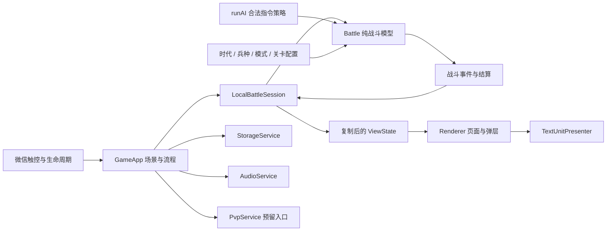

# 文字单机原型架构

更新：2026-10-07；配置版本：`text-prototype-0.2`。

当前执行顺序为文字角色 → 完整单机玩法 → 后续联网和正式美术。PvP 大厅可以进入，实际联网服务尚未接入。既有图片与动画代码保留，但当前运行路径不引用 `art-map.js` 或 `animation.js`。

## 模块与数据流

`Battle` 不读取微信 API、真实时间或图片；随机数来自可保存的种子。玩家与 AI 都走 `command(side, command)`，校验后才能扣费或修改队列。`LocalBattleSession` 把渲染时间积累为 1/30 秒逻辑步，暂停时停止全部模拟时钟。表现模块只读视图，不回写生命、位置或伤害。

| 文件 | 拥有的状态或职责 |
|---|---|
| `data.js` | 30 兵种的 ID、唯一短名、数值、标签、前摇、弹丸和图鉴说明 |
| `config/modes.js` | 经典和战役模式、15 关目标、时代范围、初始值及敌军加成 |
| `battle.js` | 金币、EXP、队列、单位、塔、弹丸、技能、种子、统计和最终结果 |
| `core/ai.js` | 三档决策频率、战役出兵组合、补兵间隔和防御策略 |
| `sessions/local.js` | 暂停、步长积累、指令应答与去重、事件缓冲和视图复制 |
| `app.js` | 当前场景、弹层、镜头、手势、设置、通关进度和服务实例 |
| `renderer.js`、`ui/screens.js` | 首页、战役、图鉴、设置、PvP 大厅、战场与通用弹层 |
| `ui/units.js` | 短名、阵营、血量、状态、密集单位分组和标签避让 |
| `services/storage.js` | 读写失败处理、数据校验、顺序解锁和结算去重 |
| `services/audio.js` | 本地短音效、音量、关闭与后台停止 |
| `services/pvp.js` | 真人匹配和房间服务的替换边界 |

## 对局会话契约

界面提交意图并读取会话结果，后续远端会话可以沿用以下方法：

| 方法或字段 | 当前行为 |
|---|---|
| `sendCommand(command, commandId?)` | 返回 `{commandId, status, errorCode?, message?}`；状态为 accepted / rejected，保留 pending 给联网等待确认 |
| `getViewState(viewerSide = 0)` | 返回复制的状态；己方显示左侧；不提供敌方金币、EXP、生产队列或技能冷却 |
| `update(elapsed)` | 本地固定步长更新；单次积累最多 0.25 秒 |
| `drainEvents()` | 取走新事件，供音效与流程使用 |
| `capabilities` | 本地 `{canPause:true, canSaveLocally:true}`；远端会话应关闭这两项 |
| `pause()`、`resume()` | 停止／继续逻辑，恢复存档默认暂停 |
| `snapshot()`、`dispose()` | 取得快照／停止当前会话并释放缓冲 |

指令种类为 `train`、`cancel`、`evolve`、`skill`、`unlock`、`build`、`upgrade`、`sell`、`surrender`。本地指令应答在当前会话内按 ID 去重，重复提交不重复扣费；恢复后开启新的会话应答缓存。未来服务端需要把已确认 ID 与对局一起持久化。

`ViewState` 中有规则、对局时间、结算、己方人口、双方可见基地及单位、在途弹丸与技能预警。左右镜像只用于视图；未来远端会话必须把右侧玩家的技能意图转换回权威坐标。`GameApp.battle` 是保留给旧测试的模型访问口，页面读取 `app.view`。

## 战斗生效顺序

每步先更新收入、技能冷却与队列，再运行 AI。已到落点的弹丸、单位前摇释放和技能脉冲产生本步效果；统一结算伤害，再按医疗／维修类型取同一步最大治疗量，最后移除死亡单位、发放一次奖励、结算基地伤害和胜负。死亡后不接受治疗。

前摇锁定目标，目标无效则重新索敌。已发射单体弹丸不转向；范围弹丸保留落点，落地时检查实际敌兵；磁轨最多命中两人，不穿透基地。攻击者与基地之间存在敌兵时不能开始攻击基地。攻城兵射程 300，塔射程 270，以形成塔下攻坚用途。

双方基地同一步归零优先判平局；其次基地摧毁；再判关卡生存目标／摧毁时限。经典对战到 20 分钟比较基地生命比例。结果只生成一次，包含模式、关卡、原因、时长及双方最高时代、产兵、击杀和基地生命。

战役 1-1、1-2 的敌军不建塔；其余关卡按配置和战线建塔。猛兽、城门、炮阵、钢铁关卡的补兵窗口也在目标与敌情页公开。窗口控制新出兵指令，队列继续生产，资源持续积累。关卡详情、AI 和模拟读取同一份配置。

## 存储与异常

| 键 | 内容 |
|---|---|
| `war.pve.snapshot.v2` | 未完成对局的模型状态，含种子、前摇和在途弹丸 |
| `war.pve.progress.v1` | 15 关成绩与最近 256 个已结算战役 ID |
| `war.settings.v1` | 声音开关、音量、简化背景 |

快照恢复校验配置版本、模式规则、时限、实体 ID、人口、队列付款和字段范围。事件和短暂表现不存档，避免恢复时重复播放或重复生效。旧版或不完整快照提供重新挑战提示。结算会清除续局；战役失败、平局、投降不解锁，胜利更新各项最佳记录。生存到时不记录为更快的通关时间，提前摧毁敌基地才比较时间。

微信同步存储失败不终止对局；本次内存成绩与设置继续有效。跨设备同步、账号进度和服务器持久化属于后续联网工作。

## 后续接入

`UnavailablePvpService` 保留 `ensureSession`、`matchmake`、`cancelMatchmaking`、`createRoom`、`joinRoom`、`leaveRoom`、`setReady`、`connectMatch`、`reconnect`。当前每项返回明确的 `PVP_UNAVAILABLE`，大厅操作仅显示说明。`LocalBattleSession` 拒绝启动 PvP，防止入口意外运行本地 AI。真实实现应返回远端会话，由服务端维护资源、时钟、合法指令与唯一结算，再补齐搜索、房间和重连场景。

正式美术接入点是 `ui/units.js` 的角色表现模块，可替换为图片或动画表现；继续使用单位 ID、状态和攻击／治疗／死亡事件。保留文字回退显示，动画时钟受会话暂停控制，动画帧率不决定伤害。恢复图集后再调整打包忽略项，无需改写经济、战役或存档流程。
